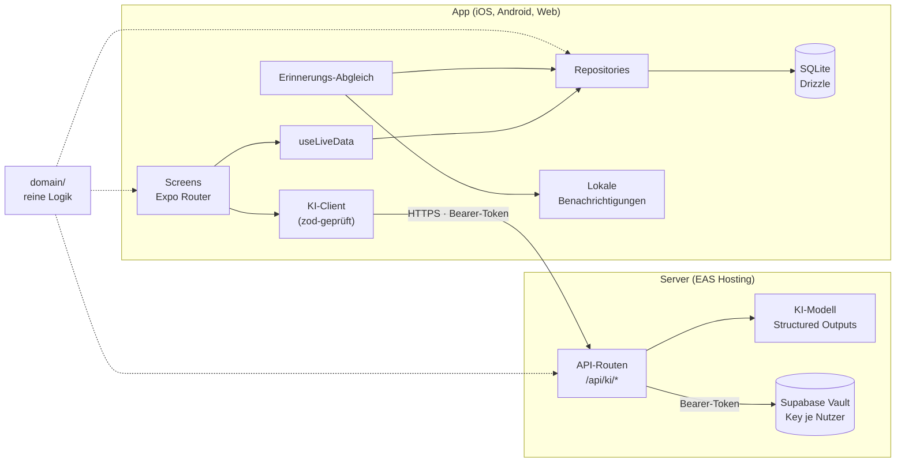

# jobpilot

**Bewerbungen im Blick behalten** – eine App für die eigene Jobsuche, von der ersten Anzeige bis zum Angebot. Für iOS, Android und Web, mit lokalem Datenspeicher, Erinnerungen und einem KI-Assistenten, der auf dem Server mit einem KI-Modell spricht.

[](https://github.com/Mythos-Brookdesign/jobpilot/actions/workflows/ci.yml)

**[Live-Demo im Browser →](https://jobpilot-demo.expo.app)** &nbsp;·&nbsp; ohne Anmeldung, mit Beispieldaten, alles bleibt im Browser

<p align="center">
  
</p>

## Funktionen

- **Pipeline** von „Gemerkt“ über Screening und Fachgespräch bis zum Angebot; jeder Statuswechsel landet im Verlauf
- **Detailseite** je Bewerbung: Eckdaten (Gehalt, Arbeitsmodell, Quelle, Link), Termine, Kontakte, Notizen, Verlauf
- **Erinnerungen** als Benachrichtigung: nachhaken, wenn sich nichts tut, Termine am Vortag und eine Stunde vorher, Dankeschön danach – mit „Erledigt“ und „Später“ direkt in der Benachrichtigung
- **KI-Assistent:** Stellenanzeige einfügen und Felder vorausfüllen lassen, Passung zum eigenen Profil, Gesprächsvorbereitung, Entwürfe für Anschreiben, Nachfass- und Dankes-Mail
- **Auswertung:** Funnel nach höchster erreichter Stufe, Antwortquote, Zeit bis zur Rückmeldung, Erfolg je Quelle, Aktivität pro Woche
- **Board-Ansicht** auf breiten Bildschirmen, Hell- und Dunkelmodus, native Tabs und Datums-Picker
- **Offline und privat:** Bewerbungen und Profil liegen lokal in SQLite; Backup als JSON, Export als CSV. Nur der KI-Schlüssel jedes Nutzers liegt verschlüsselt in Supabase (Vault)

| Übersicht                                        | Detailseite                                    | KI: Passung                                 | Auswertung                                        |
| ------------------------------------------------ | ---------------------------------------------- | ------------------------------------------- | ------------------------------------------------- |
|  |  |  |  |


## Architektur



- **`domain/`** enthält die Geschäftslogik als reine Funktionen: Pipeline, Filter, Sortierung, Formular-Validierung, Erinnerungsregeln, Auswertungen, Backup-Format, KI-Schemas. Sie wird von App, Datenbankschicht und Server gemeinsam genutzt und ist ohne React getestet.
- **Datenzugriff nur über Repositories**, geschrieben gegen jeden synchronen SQLite-Treiber von Drizzle: expo-sqlite in der App, better-sqlite3 in den Tests – die Tests prüfen echtes SQL mit denselben Migrationen.
- **Der API-Key gehört dem Nutzer.** Angemeldete Nutzer hinterlegen ihren eigenen Key für den konfigurierten Provider in den Einstellungen; er liegt verschlüsselt im Supabase Vault, die App sieht nur den Zeitpunkt der letzten Änderung. Erst die API-Routen lesen ihn – mit dem Bearer-Token des Aufrufers und nur für den Nutzer, den Supabase daraus ermittelt. Nur die öffentliche Demo nutzt weiter den Key des Servers. App und Server teilen sich die zod-Schemas für Anfragen und Antworten.

### Entscheidungen

|                                                                  |                                                                                     |
| ---------------------------------------------------------------- | ----------------------------------------------------------------------------------- |
| [ADR 1](docs/adr/0001-lokale-daten-mit-sqlite-und-drizzle.md)    | Lokale Daten mit SQLite und Drizzle, versionierte Migrationen                       |
| [ADR 2](docs/adr/0002-live-daten-mit-gebuendeltem-neuladen.md)   | Live-Daten mit gebündeltem Neuladen statt einer Abfrage pro Zeile                   |
| [ADR 3](docs/adr/0003-erinnerungen-als-idempotenter-abgleich.md) | Erinnerungen als idempotenter Abgleich von Regeln, Datenbank und Benachrichtigungen |
| [ADR 4](docs/adr/0004-patches-fuer-expo-sqlite.md)               | Zwei Fehler in expo-sqlite (Web) gefunden und per Patch behoben                     |
| [ADR 5](docs/adr/0005-ki-ueber-eigene-api-routen.md)             | KI über eigene API-Routen, Structured Outputs, abgesicherte öffentliche Demo        |
| [ADR 6](docs/adr/0006-benutzer-eigene-anthropic-schluessel.md)   | Benutzer-eigene Anthropic-Schlüssel im Supabase Vault                               |
| [ADR 7](docs/adr/0007-ki-provider-auswahl.md)                    | Wechselbarer KI-Provider (Anthropic oder OpenAI-kompatibel) über `AI_PROVIDER`      |

## Tech-Stack

- [Expo](https://expo.dev) SDK 57, React Native 0.86, React 19 mit React Compiler, Expo Router
- SQLite über `expo-sqlite` und [Drizzle ORM](https://orm.drizzle.team), im Browser per WebAssembly
- `expo-notifications` für lokale Erinnerungen
- KI-Assistent über Expo Router API Routes; welcher Dienst antwortet, legt `AI_PROVIDER` fest (siehe [KI-Assistent einrichten](#ki-assistent-einrichten)); zod für alle Schnittstellen
- TypeScript (strict), Jest mit `jest-expo`, React Native Testing Library, better-sqlite3
- ESLint, Prettier, GitHub Actions; Auslieferung über EAS Hosting

## Qualität

- **Automatisierte Tests**: Domain-Logik, Repositories gegen echtes SQLite, eine Migration mit Daten im alten Format, Erinnerungsregeln und -abgleich, KI-Server mit nachgebauten Provider-Clients, Demo-Schutz, Key-Verwaltung, Hooks und Komponenten
- CI prüft Lint, Typecheck und Tests bei jedem Push und Pull Request
- Barrierefreiheit: Labels und Rollen für Screenreader, Kontraste nach WCAG AA (Status- und Diagrammfarben rechnerisch geprüft)

## Projektstruktur

```
src/
  app/          Routen (Expo Router) – Tabs, Detailseite, Formulare, API-Routen
  domain/       reine Logik ohne React
  db/           Schema, Repositories, Datenbankanbindung, Live-Abfragen
  features/     applications/, insights/, reminders/, ai/, demo/, data-transfer/
  server/       nur für API-Routen: Provider-Auswahl, Rate-Limit (Prompts und Aufrufe aus shared-ai)
  ui/           wiederverwendbare Bausteine
  theme/        Farben für Hell und Dunkel
drizzle/        SQL-Migrationen
docs/           Architektur-Entscheidungen und Screenshots
patches/        Korrekturen an Abhängigkeiten (patch-package)
```

## Starten

Voraussetzung: Node.js 22 und ein GitHub-Token mit `read:packages`, denn `@jobpilot-org/shared-ai` kommt aus GitHub Packages. Vor `npm install` das Token in die Umgebung laden (nie in eine Datei schreiben):

```bash
set -a; . ~/.config/jobpilot/github.env; set +a
export NODE_AUTH_TOKEN="$GITHUB_PACKAGES_TOKEN"
```

```bash
npm install
npm start          # Dev-Server, dann i (iOS) oder a (Android) – oder QR-Code mit Expo Go scannen
```

### KI-Assistent einrichten

Der Assistent läuft nur auf dem Server und spricht mit genau einem KI-Dienst. Welcher, legt `AI_PROVIDER` in `.env.local` fest:

- **`anthropic`** (Standard): Anthropic mit Structured Outputs über `output_config.format`.
- **`openai`**: OpenAI oder ein OpenAI-kompatibler Endpunkt mit Structured Outputs über `response_format` und `json_schema`. `OPENAI_MODEL` wählt das Modell (Standard: `gpt-6-astra`); mit `OPENAI_BASE_URL` lässt sich ein anderer Anbieter oder ein Gateway angeben.

Angemeldete Nutzer hinterlegen ihren eigenen API-Key für den konfigurierten Provider in der App unter **Einstellungen → KI-Assistent**; die App speichert ihn nie selbst, sondern reicht ihn an die Supabase-RPC weiter, die ihn verschlüsselt im Vault ablegt. Beim Speichern prüft die App nur, dass etwas eingegeben wurde und kein Leerraum darin steckt – kein festes Präfix, damit sich Key-Formate ändern dürfen. Ob der Key gilt, zeigt die nächste Anfrage an den KI-Dienst, und ein abgelehnter Key lässt sich an derselben Stelle ersetzen.

Für die API-Routen genügt dieselbe öffentliche Supabase-Konfiguration wie in der App; ein Servergeheimnis gibt es nicht. Nur die öffentliche Demo nutzt den Server-Key des konfigurierten Providers:

```bash
cp .env.example .env.local   # AI_PROVIDER und die übrigen Werte eintragen
npm start                    # der Dev-Server stellt auch die API-Routen bereit
```

| Variable                               | Wo sie gilt          | Wofür                                                                                         |
| -------------------------------------- | -------------------- | --------------------------------------------------------------------------------------------- |
| `AI_PROVIDER`                          | nur Server           | `anthropic` (Standard) oder `openai`                                                          |
| `EXPO_PUBLIC_SUPABASE_URL`             | App **und** Server   | Projekt-URL; der Server prüft damit die Access-Tokens der App                                 |
| `EXPO_PUBLIC_SUPABASE_PUBLISHABLE_KEY` | App **und** Server   | Anmeldung und API-Zugriff; der Server reicht damit das Token des Aufrufers an Postgres weiter |
| `ANTHROPIC_API_KEY`                    | nur Server, nur Demo | Gemeinsamer Anthropic-Key der öffentlichen Demo (`JOBPILOT_DEMO=1`)                           |
| `OPENAI_API_KEY`                       | nur Server, nur Demo | Gemeinsamer OpenAI-Key der öffentlichen Demo bei `AI_PROVIDER=openai`                         |
| `OPENAI_MODEL`                         | nur Server           | OpenAI-Modell, Standard `gpt-6-astra`                                                         |
| `OPENAI_BASE_URL`                      | nur Server           | Optionaler OpenAI-kompatibler Endpunkt oder Gateway                                           |
| `JOBPILOT_DEMO=1`                      | nur Server           | Demo-Betrieb: keine Anmeldung, nur Demo-Inhalte, IP-Limit, Zwischenspeicher                   |

Ohne eigenen Key funktioniert die App normal; nur der Assistent verweist auf die Einstellungen. In der Demo führt ein fehlender Server-Key zu einer Einrichtungsmeldung. Ein unbekannter `AI_PROVIDER` wird geloggt und wie ein fehlender Key behandelt. Ohne Supabase-Konfiguration antworten die KI-Routen außerhalb der Demo mit einem Serverfehler, weil sie weder Tokens prüfen noch Keys lesen können.

Der Server hält keinen Schlüssel mit Service-Rolle: Er schickt das `Authorization: Bearer <access-token>` des Aufrufers an Supabase, und die RPC `get_ai_api_key()` liest allein über `auth.uid()` den Key dieses Nutzers. Wer ein gültiges Token dieses Nutzers besitzt, kann dessen eigenen Key lesen – nicht mehr und nicht weniger als das, was der Key ohnehin erlaubt (Verbrauch des Nutzers beim konfigurierten KI-Dienst).

Für die öffentliche Demo reicht der Server-Key: Sie läuft mit `EXPO_PUBLIC_DEMO=1` und `JOBPILOT_DEMO=1` ohne Anmeldung, und die Key-Verwaltung bleibt dort ausgeblendet.

Beide Standardmodelle erfüllen laut Herstellerdoku die Anforderungen des Assistenten: Streaming und vom Schema erzwungene Antworten. Wie hilfreich die Antworten für die eigene Bewerbung sind, prüfen die automatisierten Tests nicht – vor dem produktiven Einsatz einmal mit der eigenen Anzeige und dem eigenen Profil ausprobieren. Gegen einen echten OpenAI-kompatiblen Endpunkt wurde nicht getestet; Schema-Treue und `reasoning_effort` prüft der Betreiber beim Einrichten selbst. Kleinere, günstigere Modelle funktionieren, halten die vorgegebenen Schemas aber erfahrungsgemäß weniger zuverlässig ein.

### Anmeldung (Supabase)

Die App meldet sich mit E-Mail und Passwort an einem Supabase-Projekt an. Die beiden Werte dafür stehen in `.env` (nicht eingecheckt) und zeigen auf das Cloud-Projekt. Konten werden im Supabase-Dashboard angelegt: Die App bietet keine Registrierung, und Sign-ups sind im Projekt abgeschaltet.

#### Lokale Supabase-Instanz

```bash
cd backend && supabase start      # zeigt URLs und Keys an, auch später über: supabase status
```

Die Werte aus der Ausgabe in `mobile/.env.local` eintragen – die Datei überschreibt `.env` und ist nicht eingecheckt:

```bash
EXPO_PUBLIC_SUPABASE_URL=http://localhost:54321
EXPO_PUBLIC_SUPABASE_PUBLISHABLE_KEY=<publishable key aus der Ausgabe>
```

Der publishable Key genügt für App und Server; einen Service-Rollen-Schlüssel braucht die App nicht mehr. Er bleibt in `supabase status` sichtbar, gehört aber in keine Umgebungsdatei.

`localhost` passt für Web und iOS-Simulator. Der Android-Emulator erreicht den Rechner unter `http://10.0.2.2:54321`, ein echtes Gerät nur über die LAN-Adresse des Rechners (`http://192.168.x.x:54321`). Nach einer Änderung an den Variablen den Dev-Server neu starten. Auch lokal gilt: Nutzer im Dashboard unter `http://localhost:54323` anlegen (oder per Seed-SQL), weil Sign-ups abgeschaltet sind.

### Web-Version

```bash
npm run web:preview          # Export und Auslieferung wie in Produktion (inkl. API-Routen)
```

`npm run web` (Dev-Server) scheitert in Expo SDK 57 am SQLite-Worker („Worker chunk not found“) – ein Fehler in Expos Dev-Serializer. Die Vorschau oben ist davon nicht betroffen.

### Datenbank

```bash
# nach Änderungen an src/db/schema.ts die nächste Migration erzeugen
npm run db:generate -- --name kurze-beschreibung
```

Migrationen werden beim App-Start automatisch angewendet.

## Qualität prüfen

```bash
npm run lint       # ESLint und Prettier
npm run typecheck  # TypeScript
npm test           # Jest
npm run check      # alles zusammen, wie in der CI
```

## Web-Demo veröffentlichen

Die Demo ist die normale Web-Version mit `EXPO_PUBLIC_DEMO=1` (Beispieldaten, Hinweisband) und `JOBPILOT_DEMO=1` auf dem Server (KI nur mit den Demo-Inhalten, Antworten zwischengespeichert).

```bash
# einmalig: Umgebungsvariablen in EAS („production“)
npx eas-cli@latest env:create --environment production --name ANTHROPIC_API_KEY --visibility secret
npx eas-cli@latest env:create --environment production --name JOBPILOT_DEMO --value 1 --visibility plaintext
npx eas-cli@latest env:create --environment production --name EXPO_PUBLIC_DEMO --value 1 --visibility plaintext

npm run deploy:web   # Export mit Demo-Modus und Deployment auf EAS Hosting
```

Mit verbundenem GitHub-Repo veröffentlicht `.eas/workflows/deploy-web.yml` die Demo bei jedem Push auf `main` automatisch.

## Key-Verwaltung im Betrieb

- Die Migration `backend/supabase/migrations/*_ai_api_key.sql` legt die Tabelle, die Vault-Anbindung, die RPCs und die Rechte an. Sie einmalig auf das Cloud-Projekt anwenden (`cd backend && supabase db push`).
- In der EAS-Umgebung der echten App braucht der Server nur `EXPO_PUBLIC_SUPABASE_URL` und `EXPO_PUBLIC_SUPABASE_PUBLISHABLE_KEY`; beide sind öffentlich, `ANTHROPIC_API_KEY` ist dort nicht nötig. Ein zusätzliches Servergeheimnis gibt es nicht.
- Bestehende Konten tragen ihren eigenen Key nach dem Deployment einmal ein – der bisherige Server-Key lässt sich nicht auf Personen verteilen.
- Keys werden beim Speichern nicht gegen den KI-Dienst geprüft; ein ungültiger Key meldet sich beim nächsten KI-Aufruf und lässt sich in den Einstellungen ersetzen.
